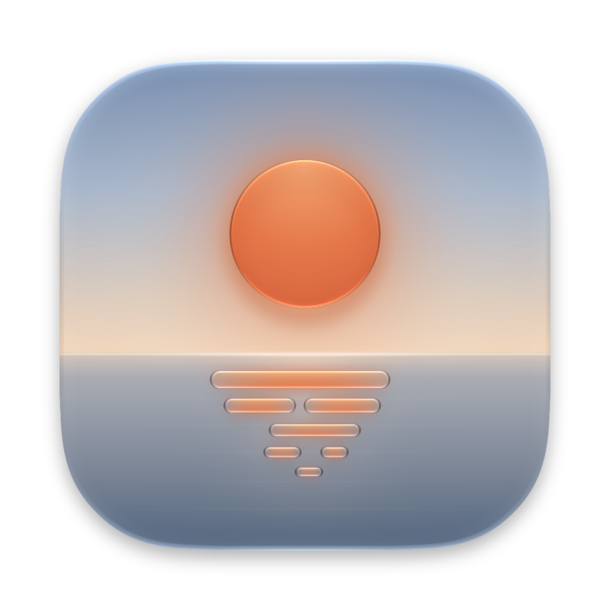
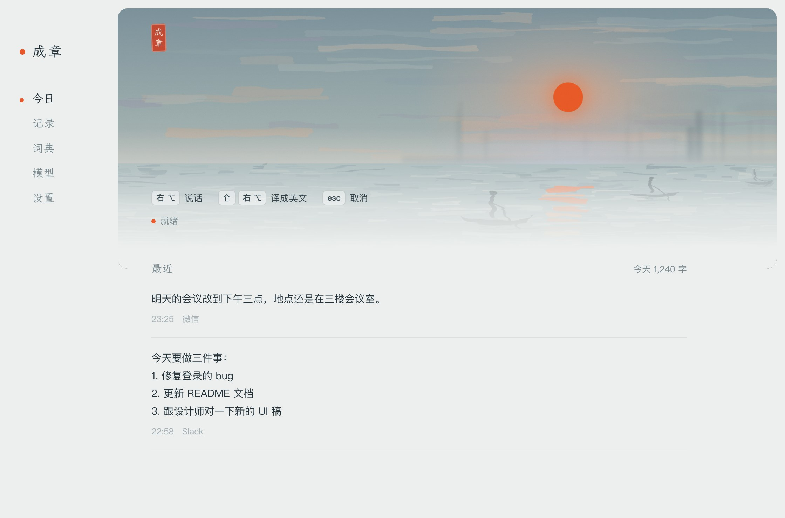
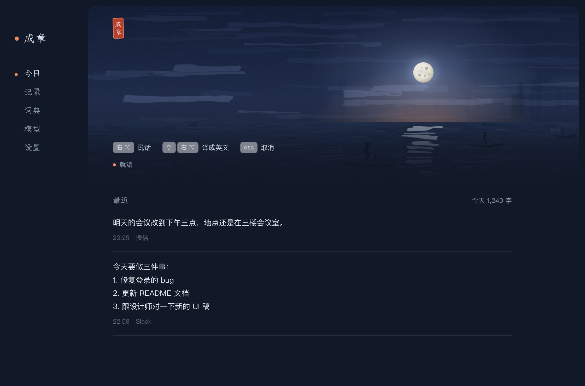
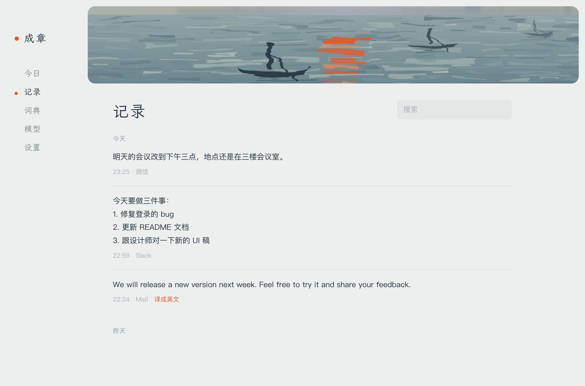
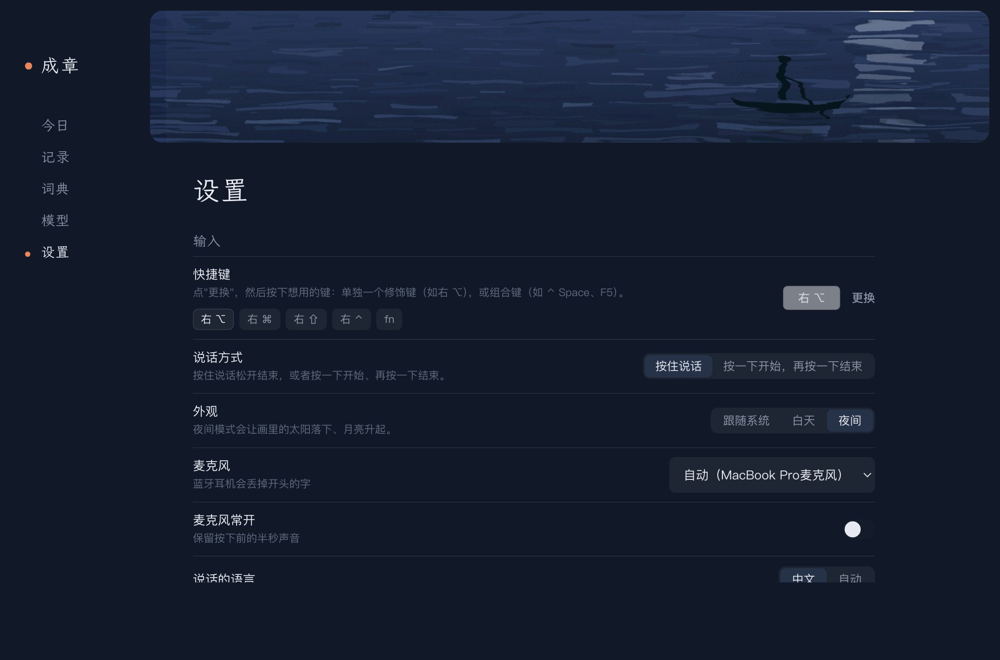

<p align="center">
  
</p>

<h1 align="center">成章</h1>

<h2 align="center">在任何地方自然输入</h2>

<p align="center">
  macOS 上的本地语音输入。在微信、Slack、邮件、编辑器里按住快捷键说话，<br>
  松开后，整理好的文字会粘贴到光标处。
</p>

<p align="center">
  <a href="https://github.com/izumedonabe/chengzhang/releases/latest"></a>
  <a href="LICENSE"></a>
</p>

<p align="center">
  
  
</p>

成章先用 Qwen3-ASR 做语音识别，再用一个小语言模型把识别结果改成书面文字：去掉"嗯""那个"之类的口头禅，处理说话中途的改口，补标点，口述的清单排成列表，需要时直接翻译。比如说"嗯那个，我们周二开会，不对，是周三"，输出是"我们周三开会。"

所有模型都通过 [MLX](https://github.com/ml-explore/mlx) 在本机运行。除了第一次下载模型，不需要联网，也不需要 API key。

**系统要求：** Apple Silicon（M1 及以后），macOS 14+。默认模型约占 4 GB 磁盘，建议 16 GB 内存。

## 安装

从 [Releases](https://github.com/izumedonabe/chengzhang/releases/latest) 下载 `Chengzhang-<version>-arm64.dmg`，把成章拖进「应用程序」。

应用没有签名，第一次打开会被 Gatekeeper 拦下。在 Finder 里右键 → 打开，或者执行：

```bash
xattr -dr com.apple.quarantine /Applications/成章.app
```

需要两项权限：

- **麦克风**：第一次录音时系统会弹窗询问。
- **辅助功能**：在 系统设置 → 隐私与安全性 → 辅助功能 里打开成章。全局快捷键和自动粘贴都依赖这一项。

首次启动会下载默认模型（约 4 GB）。

## 使用

| 快捷键 | 动作 |
|---|---|
| 按住 右⌥ | 录音，松开后输出 |
| 按住 ⇧ + 右⌥ | 录音并翻译（默认译成英文） |
| esc | 取消本次录音 |

在「设置」里可以把快捷键换成右⌘、fn 或组合键（如 ⌃Space、F5），把录音方式改成"按一下开始，再按一下结束"，以及修改翻译的目标语言。

人名、产品名、专业术语可以加到「词典」页，识别和整理时会优先使用这些写法。每次输入的原话和整理结果都保存在「记录」页。

<p align="center">
  
  
</p>

## 模型

在「模型」页切换，选中后自动从 Hugging Face 下载。也可以填任意 MLX 格式模型的 repo id。

| 用途 | 模型 | 下载大小 | 备注 |
|---|---|---|---|
| 识别 | Qwen3-ASR 0.6B（默认） | 1.0 GB | |
| | Qwen3-ASR 1.7B | 2.5 GB | 口音、噪声、术语多的场景更准，延迟约为 0.6B 的两倍 |
| 整理 | Qwen3.5 4B（默认） | 3.1 GB | |
| | Qwen3.5 2B | 1.8 GB | 更快，口头禅去得不够干净 |
| | Qwen3.5 9B | 6.0 GB | 适合长段口述 |
| | AgenticASR Refiner 1B | 0.7 GB | 针对口语转书面语微调，改动保守；不支持翻译 |
| | 无 | — | 直接输出识别结果 |

## 性能

M4 Pro / 24 GB，默认模型，从松开按键开始计时：

| | 延迟 |
|---|---|
| 首字上屏 | 0.1–0.5 s |
| 一两句话全部上屏 | 0.5–0.8 s |
| 30 秒口述全部上屏 | 1.1–1.7 s |

录音过程中，成章用 Silero VAD 在停顿处切段，边说边识别，已识别的文字会先送进整理模型做前缀缓存。松开按键时一般只剩最后一段需要处理。

```
麦克风 → Silero VAD → 按停顿切段 → Qwen3-ASR（流式）→ 整理模型（预填前缀）
松开按键 → 识别最后一段 → 生成 → 粘贴
```

测试方法和原始数据见 [docs/BENCHMARKS.md](docs/BENCHMARKS.md)。

## 从源码构建

需要 Python 3.11+ 和 [uv](https://github.com/astral-sh/uv)。

```bash
git clone https://github.com/izumedonabe/chengzhang.git
cd chengzhang
uv venv --python 3.12 .venv
uv pip install --python .venv/bin/python -e .
```

```bash
.venv/bin/chengzhang    # 桌面应用
.venv/bin/otl           # 命令行版本，按 Enter 开始/结束录音
```

打包 dmg（需要 Xcode Command Line Tools），产物在 `dist/`：

```bash
.venv/bin/python tools/build_dmg.py
```

用户数据（设置、词典、记录）保存在 `~/Library/Application Support/Chengzhang/`，模型缓存在 `~/.cache/huggingface/`。

界面基于 pywebview。设计说明见 [docs/DESIGN.md](docs/DESIGN.md)。

## 致谢

- [Qwen3-ASR](https://arxiv.org/abs/2601.21337)、[Qwen3.5](https://huggingface.co/Qwen)
- [AgenticASR](https://github.com/AnXMuy/AgenticASR)（Refiner 模型）和 [AASR-Bench](https://huggingface.co/datasets/Andrew0425/AASR-Bench)（整理效果评测）
- [MLX](https://github.com/ml-explore/mlx)、[mlx-lm](https://github.com/ml-explore/mlx-lm)、[mlx-audio](https://github.com/Neywa-Labs/mlx-audio)
- [Silero VAD](https://github.com/snakers4/silero-vad)
- [pywebview](https://pywebview.flowrl.com)
- [霞鹜文楷](https://github.com/lxgw/LxgwWenKai)（已安装时使用）
- 首页的画参考了莫奈的《印象·日出》（1872）

## 许可

[MIT](LICENSE)。模型权重各自有许可证，以 Hugging Face 上的说明为准。
